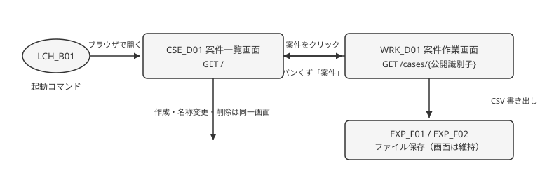

# 画面遷移図

[← 機能一覧](01-機能一覧.md)

| 画面 / 機能 | アクション | 遷移先 |
| ----------- | ---------- | ------ |
| （起動） | LCH_B01 でプロセス起動し、ブラウザで開く | CSE_D01 案件一覧画面 |
| CSE_D01 | 案件をクリック | WRK_D01 案件作業画面 |
| CSE_D01 | 案件を作成・名称変更・削除 | CSE_D01（同一画面） |
| WRK_D01 | パンくず「案件」 | CSE_D01 |
| WRK_D01 | 一致行／集計結果を CSV 書き出し | EXP_F01 / EXP_F02（ファイル保存。画面は WRK_D01 のまま） |
