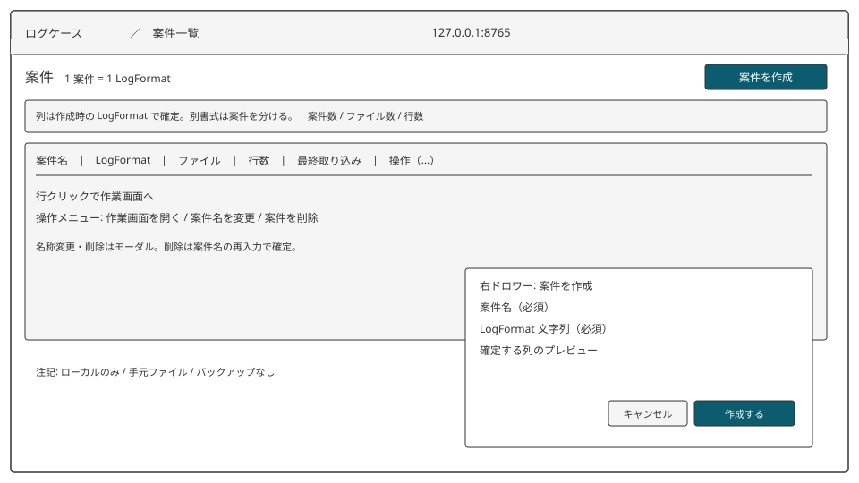

# CSE_D01 案件一覧画面 基本設計書

[← 機能一覧](01-機能一覧.md) · [データ](03-データ構造設計.md) · [メッセージ](05-メッセージ一覧.md)

## 概要

エンドポイント: `GET /`

案件の作成、一覧、名称変更、削除。行クリックで WRK_D01 へ移る。起動直後の画面。

## 画面レイアウト

上端は共通バー（プロダクト名、パンくず「案件一覧」、待受表示）。本文は「案件」見出しと右上の「案件を作成」。作成は右ドロワー（案件名、LogFormat、列プレビュー）。一覧は表。行の操作はメニューから名称変更・削除のモーダルを開く。出すものと操作の意味は本設計に従う。

## 画面項目定義

| 項目名 | 種類 | 必須 | 初期値 | 説明 |
| ------ | ---- | ---- | ------ | ---- |
| 案件名 | テキスト | ○（作成・名称変更時） | 空 | 1〜100 文字。前後空白は除く。作成ドロワー / 名称変更モーダル |
| LogFormat文字列 | テキストエリア | ○（作成時） | 空 | 登録後は画面上読み取り専用（表の先頭表示）。作成ドロワー |
| 案件一覧 | 表 | — | `data/` の案件 | 列: 案件名、LogFormat先頭、ファイル数、行数、最終取り込み日時、操作 |
| 名称変更 | ボタン | — | — | 行の操作メニュー → モーダル |
| 削除 | ボタン | — | — | 行の操作メニュー → モーダル。確認のため案件名を再入力する |
| 作成 | ボタン | — | — | 「案件を作成」でドロワーを開き、ドロワー内で送信 |

## アクション定義

### 初期表示時

1. `data/` の案件ファイルを列挙する
2. 各案件の案件名、LogFormat文字列の先頭、取り込みファイル数、アクセスログ行数、取り込み日時の最大を表に出す
3. ファイルが読めない案件は行を出さず、理由を画面に出す（E_CSE_EXS01 相当のシステム表示。想定: 壊れたファイル名を出す）

### 作成ボタン押下時

1. 案件名の前後空白を除く
2. 入力チェック（下表）
3. [CSE_C01](CSE_C01-LogFormat解析.md) で定義を生成する。失敗なら登録しない
4. 案件公開識別子（UUID v4）を発番する
5. 案件ファイルを `data/{案件公開識別子}.sqlite` に作り、案件とログフィールド定義を保存する
6. S_CSE_OK01 を出し、一覧を再表示する

##### 入力チェック一覧

| 項目名 | 内容 | メッセージコード |
| ------ | ---- | ---------------- |
| 案件名 | 必須 | E_CSE_REQ01 |
| 案件名 | 1〜100 文字 | E_CSE_FMT01 |
| LogFormat文字列 | 必須 | E_CSE_REQ02 |
| LogFormat文字列 | 解釈できること | E_CSE_FMT02 |
| LogFormat文字列 | フィールド識別子が一意 | E_CSE_DUP01 |

### 名称変更ボタン押下時

1. 対象行の新しい案件名を入力する
2. 案件名チェック（E_CSE_REQ01 / E_CSE_FMT01）
3. LogFormat文字列は変更しない
4. 案件名を更新し S_CSE_OK02。ファイル名（UUID）は変えない

### 削除ボタン押下時

1. W_CSE_BIZ01 で確認する。キャンセルなら何もしない
2. 案件ファイルを削除する。取り消せない
3. S_CSE_OK03。一覧から消える

### 行クリック時

WRK_D01 `GET /cases/{案件公開識別子}` へ遷移する。ファイルが無ければ E_CSE_EXS01。
