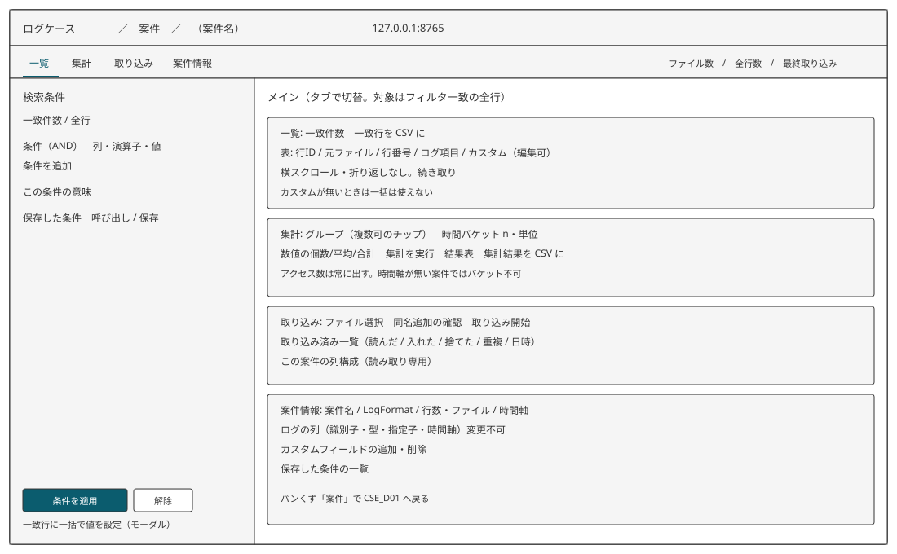

# WRK_D01 案件作業画面 基本設計書

[← 機能一覧](01-機能一覧.md) · [データ](03-データ構造設計.md) · [メッセージ](05-メッセージ一覧.md) · [CSE_C01](CSE_C01-LogFormat解析.md) · [EXP_F01](EXP_F01-一致行CSV.md) · [EXP_F02](EXP_F02-集計結果CSV.md)

## 概要

エンドポイント: `GET /cases/{案件公開識別子}`

1 案件の取り込み、フィルタ、一覧、カスタムフィールド、一括設定、集計、CSV 起動。配置は実装後に調整してよい。

## 画面レイアウト

上端は共通バー（パンくず「案件 / 案件名」。案件で CSE_D01 へ戻る）。その下はタブ（一覧 / 集計 / 取り込み / 案件情報）と件数メタ。左は検索条件レール（全タブ共通）。右がタブ本体。一括設定はレール下部からモーダル。フィルタ・一括・集計・CSV の対象は、画面に見えている範囲ではなく適用中条件の全一致行。

## 画面項目定義

### 案件情報（タブ「案件情報」）

| 項目名 | 種類 | 必須 | 初期値 | 説明 |
| ------ | ---- | ---- | ------ | ---- |
| 案件名 | 表示 | — | 案件 | 名称変更は CSE_D01 |
| LogFormat文字列 | 表示 | — | 登録値 | 変更不可 |
| 列一覧 | 表 | — | ログフィールド定義 | フィールド識別子とフィールド型。時間軸ならその旨 |
| カスタムフィールド名 | テキスト | ○（追加時） | 空 | 1〜100 文字。前後空白除去 |
| カスタム追加 | ボタン | — | — | |
| カスタム削除 | ボタン | — | — | 行ごと |
| 一覧へ戻る | リンク | — | — | パンくず「案件」。CSE_D01 |

### 取り込み（タブ「取り込み」）

| 項目名 | 種類 | 必須 | 初期値 | 説明 |
| ------ | ---- | ---- | ------ | ---- |
| ログファイル | ファイル複数可 | ○ | — | access_log または .gz |
| 取り込み開始 | ボタン | — | — | |
| 進行 | 表示 | — | — | 同一応答で更新 |
| 取り込み済み一覧 | 表 | — | 取り込みファイル | 元ファイル名、読んだ／入れた／捨てた／重複、取り込み日時。各行に削除 |

取り込んだファイルは元ファイル名単位で消せます。同じ名前の履歴はまとめて消えます。

### フィルタ（左レール。全タブ共通）

| 項目名 | 種類 | 必須 | 初期値 | 説明 |
| ------ | ---- | ---- | ------ | ---- |
| 条件行 | 繰り返し | — | なし＝全件 | 列、演算子、値。複数列は AND。複数選択は OR。等しくない／複数選択以外は指定値でない（未設定は残す） |
| 適用 | ボタン | — | — | |
| 解除 | ボタン | — | — | 全件に戻す |
| 一致件数 | 表示 | — | — | 全行数との対比も出す |
| フィルタ名 | テキスト | ○（保存時） | 空 | 1〜100 文字 |
| 保存 | ボタン | — | — | |
| 呼び出し | 選択 | — | — | 名前付きフィルタ。レール内の一覧から選ぶ |

演算子はフィールド型による。

- 文字列: 等しい、等しくない、含む、含まない、始まる、始まらない、複数選択、複数選択以外、以上、以下（辞書順、大文字小文字区別）
- 数値: 未設定、等しい、等しくない、より大きい、以上、より小さい、以下
- 日時: 未設定、等しい（秒まで）、より前、以降、より後、以前。値は日付と時刻。TZ は選ばない

### 一覧（タブ「一覧」）

| 項目名 | 種類 | 必須 | 初期値 | 説明 |
| ------ | ---- | ---- | ------ | ---- |
| 一覧表 | 表 | — | 行ID順 | 行ID、元ファイル名、ファイル内行番号、ログ項目、カスタム。カスタムセルのみ編集可。空は未設定。セルは折り返さず横スクロール |
| 並び | 選択 | — | 行ID（取り込み順） | 行ID（取り込み順）／Time の昇順（同着は行番号昇順）／Time の降順（同着は行番号降順）。Time が無い案件では出さない。変更したら一覧を先頭から取り直す。フィルタではリセットしない |
| 続き | リンク | — | — | 行ID並びは直前の行IDより後。Time 並びは直前の `(time_abs, line_no)` より後（降順はより前）。全件ロードしない |

### 一括入力（レール下部 → モーダル）

| 項目名 | 種類 | 必須 | 初期値 | 説明 |
| ------ | ---- | ---- | ------ | ---- |
| 対象カスタムフィールド | 選択 | ○ | — | |
| 値 | テキスト | — | 空 | 空は未設定へ戻す |
| 一括実行 | ボタン | — | — | 見えている行ではなくフィルタ一致全体。実行前に件数確認 |

### 集計（タブ「集計」）

| 項目名 | 種類 | 必須 | 初期値 | 説明 |
| ------ | ---- | ---- | ------ | ---- |
| グループ列 | 複数選択 | — | — | ログまたはカスタム。チップで複数可 |
| 時間バケット | チェック＋n＋単位 | — | 使わない | n は 1 以上の整数。単位は秒／分／時間。日時型 Time が無い案件では選べない |
| 数値集計 | 列と個数／平均／合計 | — | — | アクセス数（行数）は常に結果へ出す |
| 集計実行 | ボタン | — | — | 対象はフィルタ一致行 |
| 結果表 | 表 | — | — | |

### CSV

| 項目名 | 種類 | 必須 | 初期値 | 説明 |
| ------ | ---- | ---- | ------ | ---- |
| 一致した行を書き出す | ボタン | — | — | EXP_F01。一覧タブ |
| 集計結果を書き出す | ボタン | — | — | EXP_F02。集計タブ。結果が無いときは使えない |

## アクション定義

### 初期表示時

1. 案件公開識別子のファイルが無ければ E_CSE_EXS01 を出し CSE_D01 へ戻す
2. 案件情報、列一覧、カスタム定義、取り込み済み、名前付きフィルタ一覧を出す
3. フィルタ未適用。一覧は先頭から続き取り

### 取り込み開始押下時

1. ファイル必須 E_WRK_REQ01。拡張子が access_log / 無拡張子テキスト / .gz 以外は E_WRK_FMT01（想定: 名前が access_log で終わるか .gz）
2. 元ファイル名が既存なら W_WRK_BIZ01。キャンセルならそのファイルは飛ばす
3. gzip なら展開しながら読む
4. 各行の末尾改行を除いた文字列をログ行内容とする。案件内（当該トランザクションで既に入れた行を含む）に同一のログ行内容があれば登録せず重複として数える。既存行のカスタムフィールドは変えない
5. 未登録の行を CSE_C01 の行マッチ（指定子を正規表現に置換した先頭一致）で分割する。失敗行は捨てる
6. 解釈できた新規行を 1 トランザクションで挿入する。行ID は案件内の最大＋1 から連番
7. 途中失敗はロールバックし E_WRK_SYS01（以前の取り込みは残る）
8. 成功したら取り込みファイルを記録し I_WRK_INF01（読んだ／入れた／捨てた／重複）。進行は同一応答で流す

### 取り込みファイル削除押下時

1. 元ファイル名必須。空または履歴に無ければ何もしない
2. confirm が無ければ W_WRK_BIZ05（ファイル名と行数）を出して取り込みタブに留まる
3. confirm=1 ならその元ファイル名の行・値・同じ名前の履歴を 1 トランザクションで消す。失敗は E_WRK_SYS01
4. 成功は S_WRK_OK03。集計キャッシュを捨て、取り込みタブを取り直す

### フィルタ適用時

1. 数値条件の値が数値でなければ E_WRK_FMT02。日時でなければ E_WRK_FMT03
2. 複数列は AND。1 列の複数選択は OR。等しくないは指定値と完全一致しない行（未設定を含む）。複数選択以外は指定値のいずれとも完全一致しない行（未設定を含む）
3. 一致件数を出し、一覧を先頭から取り直す（並びは変えない）

### フィルタ解除時

条件を空にし全件に戻す。

### フィルタ保存時

1. フィルタ名必須 E_WRK_REQ04。1〜100 文字でなければ E_WRK_FMT04
2. 同名があれば W_WRK_BIZ03。キャンセルなら保存しない。OK なら上書き
3. 条件内容を保存し S_WRK_OK02

### フィルタ呼び出し時

存在しなければ E_WRK_EXS01。あれば条件を復元して適用する。

### 一覧スクロール時

直前のカーソルより後を、同じフィルタと同じ並びで取る。

### カスタムセル編集時

ログ列は更新しない。空なら未設定。それ以外は文字列値としてその行だけ更新する。

### カスタム追加時

チェック: E_WRK_REQ03、E_WRK_FMT04、E_WRK_DUP01、E_WRK_DUP02。成功したら定義を足し、一覧・フィルタ・集計の対象に出す。

### カスタム削除時

W_WRK_BIZ04。OK なら定義と値を削除する。取り消せない。

### 一括実行時

1. 対象カスタムフィールド必須 E_WRK_REQ02
2. いまのフィルタの一致件数を W_WRK_BIZ02 で確認。キャンセルなら変更なし
3. 一致行すべてを更新（空なら未設定）。S_WRK_OK01

### 集計実行時

1. 時間バケットを使うのに時間軸が無ければ E_WRK_CMB01
2. n が 1 以上の整数でなければ E_WRK_RNG01
3. 対象はフィルタ一致行。Time 未設定行は時間バケット集計から除く
4. アクセス数は常に出す。文字列・数値の個数は未設定でない行数。平均・合計は未設定を除く。`%b` の 0 は合計に含める
5. 結果表を出す

### CSV ボタン押下時

EXP_F01 または EXP_F02 を呼ぶ。保存ダイアログは利用者が選ぶ。

## 共通処理

### 続き取り

一覧は並びのキーセットで一定件数だけ返す。行ID並びは行ID、Time 並びは時刻とファイル内行番号。1 回あたりの件数は実装で決める（想定: 100）。

### フィルタ一致の対象

一括と CSV と集計は、画面に見えている範囲ではなく、適用中条件の全一致行を対象にする。
