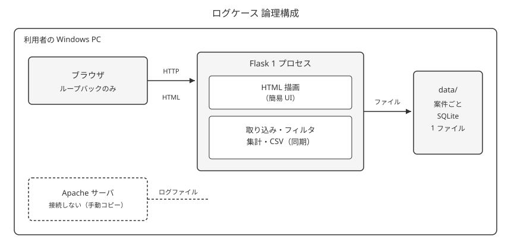

# ログケース 方式設計書

## 1. はじめに

### 1.1 目的

手元一人用のログケースについて、実行形態・スタック・データ・セキュリティ・配置を決め、基本設計の入力にする。

### 1.2 対象読者

実装するバックエンド担当（利用者と同一）。画面は簡易 UI として本方式に含める。見た目の詳細は対象外。

### 1.3 用語定義

| 用語 | 定義 |
|------|------|
| 利用者 | 開発・運用・調査を一人で行う人 |
| プロセス | Flask で HTML と処理を担う、起動中の 1 プロセス |
| 案件ファイル | 案件 1 つに対応する SQLite ファイル |
| ループバック | その PC 内のブラウザだけが届く待ち受け |

要件定義書の用語（案件、アクセスログデータ、フィールド、取り込み）をそのまま使う。

### 1.4 関連文書

| 文書名 | パス | 備考 |
|--------|------|------|
| 要件定義書 | `docs/要件定義/00-全体.md` | 入力 |
| 観点別 | `Axx-*.md` | 本成果物 |
| 基本設計 | `docs/基本設計/` | 未着手 |
| 添付 | `assets/` | 論理構成図 |

## 2. システム概要と前提

### 2.1 背景

表計算では行数上限・重さ・任意時間単位の集計が苦しい。サーバから手動コピーした Apache ログを、案件単位で調べる。

### 2.2 スコープ

- **対象**: 1 プロセスのサーバサイド描画、SQLite 配置、同期処理、ループバック公開、Windows 上のソース配置
- **対象外**: 画面の見た目詳細、API 項目、テーブル物理設計、外部インフラ、CI（想定: 置かない）

### 2.3 前提・制約

| 区分 | 内容 |
|------|------|
| 実装方式（面ごと） | 調査画面＝組み込み（同一プロセスが HTML を返す）。面は 1 つ |
| 管理画面の利用者 | 自分（開発者＝利用者）。簡易 UI をバックエンドと同じ担当が作る |
| インフラ体制 | 社内構築相当。自分の PC に自分で置く。委託しない |
| ビジネス制約 | 一人・都度利用。料金のかかる基盤を置かない |
| 技術制約 | Windows のみ。Python が入っていること（デメリット承知） |
| 運用制約 | バックアップ機能なし。消失時はサーバから取り直し |
| その他 | 対象 OS の未決 O-001 は本方式で Windows のみに閉じた |

### 2.4 非機能の目標（インプット）

| 区分 | 目標 / 指標 | 出典 |
|------|-------------|------|
| 性能 | 数百万件でも落ちない。待ちは分単位まで許容 | 要件 R05 |
| 可用性 | 起動中だけ使えればよい。冗長化なし | 要件 R05 |
| セキュリティ | 外に出さない。認証なし。マスキングなし | 要件 R05 |
| その他 | 監視なし。件数打ち切りなし | 要件 R05 / R07 |

## 3. アーキテクチャ概要

### 3.1 全体方針

Windows 上でコマンドから Flask を 1 プロセス起動し、ループバックへ HTML を返す。案件データは `data/` 配下の SQLite ファイル。長い処理もリクエスト内で同期する（切断で中断しうる点はデメリット承知）。外部システムには接続しない。

### 3.2 論理構成

### 3.3 物理構成（サマリ）

詳細は [A01](A01-システム構成.md) / [A08](A08-デプロイ・インフラ.md)。

| 環境 | 用途 | 主な構成 |
|------|------|----------|
| 開発 | 改修と調査を兼ねる | 同じ Windows PC。ソース + venv + `data/` |
| 検証 | 該当なし | 専用環境は置かない（費用抑制） |
| 本番 | 開発と同一 | 同上 |

### 3.4 技術スタック（サマリ）

詳細は [A02-技術スタック.md](A02-技術スタック.md)。

| 領域 | 採用技術 | 備考 |
|------|----------|------|
| フロントエンド | Flask テンプレート（Jinja2） | 別 FE アプリなし |
| バックエンド | Python / Flask | 1 プロセス |
| データストア | SQLite（案件 1 ファイル） | 標準ライブラリ |
| インフラ / 実行基盤 | 利用者の Windows PC | クラウドなし |
| その他 | gzip・sqlite3 は標準ライブラリ | |

## 4. 観点一覧

| ID | 観点 | 概要 | 設計書 |
|----|------|------|--------|
| A01 | システム構成 | 1 PC・1 プロセス・ループバック | [A01-システム構成.md](A01-システム構成.md) |
| A02 | 技術スタック | Python / Flask / SQLite | [A02-技術スタック.md](A02-技術スタック.md) |
| A03 | 処理方式 | 同期。進行は同一応答 | [A03-処理方式.md](A03-処理方式.md) |
| A04 | データ方式 | 案件ごと SQLite | [A04-データ方式.md](A04-データ方式.md) |
| A05 | 連携方式 | 外部接続なし | 該当なし（手動ファイルのみ。要件 R04） |
| A06 | セキュリティ方式 | 認証なし・ループバック固定 | [A06-セキュリティ方式.md](A06-セキュリティ方式.md) |
| A07 | 可用性・性能・運用監視 | 冗長化なし・監視なし | [A07-可用性・性能・運用監視.md](A07-可用性・性能・運用監視.md) |
| A08 | デプロイ／インフラ | ソース + venv + `data/` | [A08-デプロイ・インフラ.md](A08-デプロイ・インフラ.md) |

## 5. 主要な選定サマリ

| 決定事項 | 採用 | 却下案 | 理由（要約） | 詳細 |
|----------|------|--------|--------------|------|
| 画面担当 | 自分で簡易 UI | デザイナ／別 FE、CLI のみ | 一人用。見た目は後で調整 | 全体 2.3 |
| 面の方式 | 同一プロセスが HTML | JSON API 分離、別プロセス | 構築費が最小 | A01 |
| 配置 | 自分の PC | 委託、クラウド | 公開しない。料金なし | A08 |
| 起動 | 都度 1 プロセス | 常駐、都度 CLI | 都度調査と一致 | A01 |
| 言語 | Python | Go、Node | ログ解釈と HTML の構築が安い | A02 |
| Web | Flask | Django、標準 HTTP のみ | 依存が小さく SSR に足りる | A02 |
| 長い処理 | 同期（同一応答で進行） | プロセス内裏実行、外部バッチ | ジョブ管理の構築費を払わない。切断中断はデメリット承知 | A03 |
| データ | 案件ごと SQLite | DuckDB、PostgreSQL | 一括更新と案件削除が単純。サーバ運用費なし | A04 |
| 認証 | なし + ループバック | アプリパスワード、プロキシ | 削れない非機能は「外に出さない」 | A06 |
| 監視 | なし | ログファイル、SaaS | 都度起動。料金なし。コンソール閉鎖はデメリット承知 | A07 |
| OS | Windows のみ | 他 OS 検証 | 検証費抑制。O-001 を閉じた | A08 |
| 配布 | ソース + venv + `data/` | exe、pip | 改修のたびに梱包しない。Python 必須はデメリット承知 | A08 |

## 6. リスク・未決事項

### 6.1 リスク

| ID | 内容 | 影響 | 対策方針 | 状態 |
|----|------|------|----------|------|
| R-001 | 同期処理中にブラウザを閉じると取り込み／CSV が中断する | そのファイル分は確定しない（要件どおり） | 画面に注意を出す。裏実行は採用しない（費用抑制・デメリット承知） | Open |
| R-002 | 実行に Python が必要 | 未導入 PC では起動できない | 起動の前提として明記。exe 化は却下 | Open |
| R-003 | SQLite の条件なし全件集計が遅くなる | 分単位の待ち（要件上は合格） | 索引方針は基本設計。必要なら DuckDB へ移行を再検討 | Open |

### 6.2 未決事項

方式としての未決はなし。ループバックのポート番号は固定とする合意まで。具体番号は基本設計（想定 8765）。

| ID | 内容 | 影響範囲 | 担当 | 期限 | 状態 |
|----|------|----------|------|------|------|
| — | なし | | | | |

### 6.3 変更管理方針

- 観点 ID とパスを明記して改める
- テーブル定義、画面項目、URL は基本設計へ
