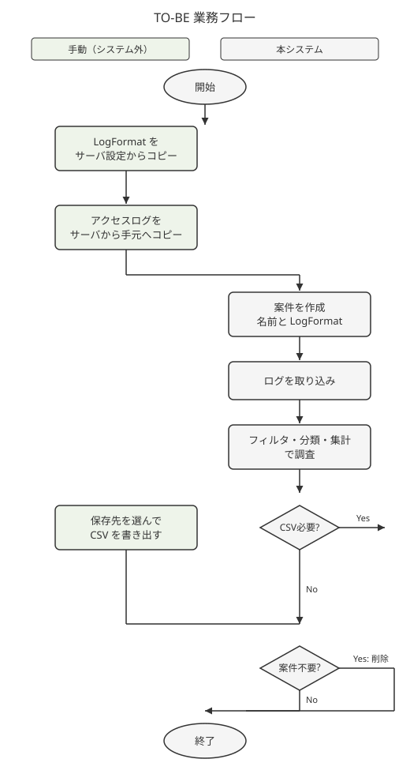

# R01 業務フロー

[← 全体](00-全体.md)

## 1. 本章の位置づけ

システム化しない手作業を含む、調査業務の現状と将来。対応機能は [R02](R02-機能要件.md)、手動の詳細は [R06](R06-業務運用要件.md)。

## 2. 本文

### 2.1 AS-IS（現状）

1. 対象サーバの Apache 設定から `LogFormat` を自分で確認する（手動）
2. サーバに入り、`access_log` または `.gz` を手元へコピーする（手動。手段は問わない）
3. 表計算に貼り、列に分ける（手動。案件ごとに書式が違う）
4. フィルタと集計で、機能別件数・不正の疑い・不審なアクセスを調べる
5. 必要なら表計算のまま保存または別ファイルに書き出す

制約（対話）: 行数上限、貼り付け・集計の重さや落ち、任意の時・分・秒単位の集計が苦手。

### 2.2 TO-BE（将来）

1. 対象サーバの Apache 設定から `LogFormat` 文字列を自分でコピーする（手動）
2. サーバからログファイルを手元へコピーする（手動。本システムはサーバに接続しない）
3. 本システムで案件を作り、案件名と `LogFormat` を登録する
4. 手元のファイルを取り込む
5. フィルタ・カスタムフィールド・集計で調査する。よく使う条件は名前付きフィルタとして残す
6. 必要なら、保存先を選んで CSV を書き出す（手動で場所を選ぶ）
7. 不要になった案件は、案件ごと削除する

データが消えた場合は、2 から取り直す。カスタムフィールドと名前付きフィルタは失い、必要なら分類し直す（対話）。

### 2.3 フロー図

### 2.4 例外・分岐

| 条件 | 処理 | 担当 | システム / 手動 |
| ---- | ---- | ---- | --------------- |
| `LogFormat` が解釈できない、または識別子が重複 | 案件を登録しない。理由を画面に出す | 利用者 | システム |
| ログ行が解釈できない | その行だけ捨て、件数に出す。ファイル全体は止めない | 利用者 | システム |
| 同じファイル名が既にある | 足す前に確認。キャンセルなら何も足さない | 利用者 | システム |
| ログ 1 行の内容が案件内に既にある | その行は登録しない。重複件数に出す。既存行は変えない | 利用者 | システム |
| 取り込みの途中で失敗 | そのファイル分は確定しない。以前の取り込みは残る | 利用者 | システム |
| CSV が必要 | 保存先とファイル名を選んで書き出す | 利用者 | システム＋手動 |
| 案件が不要 | 確認のあと案件ごと削除。取り消せない | 利用者 | システム |
| 手元データが消失 | サーバからログを取り直し、必要なら再分類 | 利用者 | 手動 |
